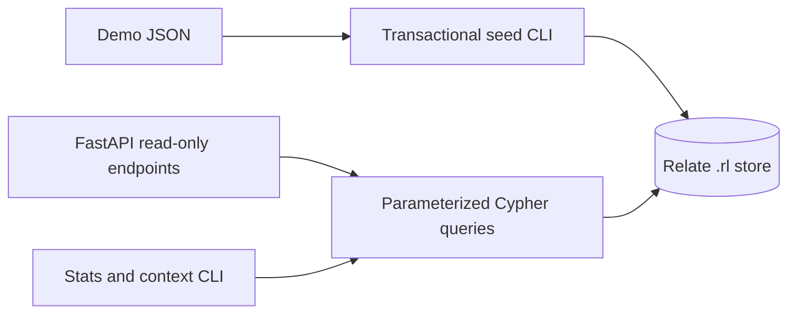

# TraceWeaver

**Graph-Verified AI Incident Investigator**

Sprint 00: Foundation, Real Relate Integration & Technical Verification

TraceWeaver prepares connected incident context for investigations: affected services,
dependencies, deployments, code or configuration changes, alerts, and evidence with provenance.
Sprint 00 delivers a working local graph, Python CLI, and read-only HTTP API. AI investigation
and root cause inference are **planned**, not implemented.

## Hackathon context

Prepared for the **Relate by Neo4j Hackathon 2026**, theme **Context, Connected**. All included
records are synthetic **demo data**. They do not represent a real company or production incident.

## Why connected context matters

A payment error metric alone does not explain which dependency, rollout, or change deserves
inspection. TraceWeaver follows actual graph edges from an incident to its affected service,
upstream dependencies, deployments, and changes. It keeps competing candidates and source
evidence visible. **A connected deployment is not a proven cause.**

## Why Relate is essential

The application embeds **`relate-db==1.0.0`**, imported as `relate`. Cypher creates and reads
every graph entity. The context endpoint traverses graph relationships at request time;
it does not return fixture records or a prepared analysis answer. Persistence is a local
single-file `.rl` store. No hosted database, credentials, Docker, or paid service is required.
The optional Relate CLI is a development tool, not a runtime dependency.

Relate is an experimental Neo4j Labs project. See its
[official repository](https://github.com/relatedb/relate) and
[limitations](https://relatedb.ai/docs/reference/limitations/).

## Architecture



- `config.py`: environment configuration and persistent path validation.
- `storage.py`: context-managed Relate connections, errors, transactions, and graph counts.
- `schema.py` / `seed.py`: ID constraints, fixture validation, and additive idempotent import.
- `queries.py`: bounded graph traversals and incident context assembly.
- `models.py`: Pydantic graph entities and HTTP response contracts.
- `api.py` / `cli.py`: thin HTTP and terminal entry points.

See [Architecture](docs/ARCHITECTURE.md), [Graph schema](docs/GRAPH_SCHEMA.md), and the
[Sprint 00 verification report](docs/SPRINT_00_REPORT.md).

## Graph model overview

The fixture contains **21 nodes and 27 directed relationships**:

| Node label | Count | Example |
| --- | ---: | --- |
| Incident | 2 | `INC-001`: Payment API 5xx error spike |
| Service | 5 | Payment API, Auth Service, Ledger Service |
| Deployment | 3 | Auth token rotation rollout |
| Change | 3 | Token rotation configuration |
| Evidence | 6 | Auth logs, metrics, distributed traces |
| Alert | 2 | Payment error budget alert |

`INC-001` connects Payment API to Auth Service and its token rotation deployment/change.
A separate Payment API deployment is another investigation candidate. `INC-002` concerns
Notification Service and Message Queue, with independent deployment and evidence records.

## Windows setup and installation

Use Windows x64, PowerShell, Git, and CPython **3.11 or later**. Python 3.11/3.12 are good
choices if already installed. This sprint was verified locally on CPython **3.14.0 x64**;
Relate's `cp39-abi3-win_amd64` wheel supports the installed interpreter. A new Python installation
is unnecessary if your supported interpreter can install the wheel.

From the repository root:

```powershell
python --version
git --version
python -m venv .venv
.\.venv\Scripts\Activate.ps1
python -m pip install -r requirements-dev.lock -e ".[dev]"
python -m pip check
```

If PowerShell policy prevents activation, run commands with
`.\.venv\Scripts\python.exe` instead of changing system policy. For example:

```powershell
.\.venv\Scripts\python.exe -m traceweaver seed --database ./data/traceweaver.rl
```

For a runtime-only installation, use `python -m pip install .` inside the virtual environment.
Developers refreshing dependencies can use `python -m pip install -e ".[dev]"` and reverify
the suite before updating `requirements-dev.lock`. The lock file records the verified development
environment without machine-specific paths.

On Linux, the equivalent activation is `source .venv/bin/activate`.

### Configuration

`.env.example` documents `TRACEWEAVER_DATABASE`; the application does not automatically load
`.env` files. Set it explicitly if you want to override `./data/traceweaver.rl`:

```powershell
$env:TRACEWEAVER_DATABASE = './data/traceweaver.rl'
```

Paths are relative to the process working directory. CLI `--database` overrides the environment.
The API requires a persistent `.rl` file and always opens it read-only.

### Optional official Relate CLI

Python application commands below do not require this tool. On Windows x64, download
`relate-windows-amd64.exe` and `SHA256SUMS` from the
[official v1.0.0 release](https://github.com/relatedb/relate/releases/tag/v1.0.0).
Use `Get-FileHash -Algorithm SHA256` and compare with the exact filename entry in `SHA256SUMS`
**before** executing the downloaded binary. Rename it to `relate.exe` in a user tool directory
on your PATH, or invoke its full path.

```powershell
relate --version
relate --mode envelope 'RETURN 1 AS ok'
relate skill install --agent codex
relate agent-context
```

Do not run the Linux/macOS `install.sh` directly in PowerShell. The CLI skill installer in
v1.0.0 could not resolve its Codex destination in the verified Windows environment. The CLI
itself, including queries and `agent-context`, worked. This does not prevent Python use;
see the report for the exact limitation. The Python wheel also includes a readable Relate
Python `SKILL.md` under its `.agents/skills/relate/` directory.

## Seeding demo data

```powershell
python -m traceweaver seed --database ./data/traceweaver.rl
python -m traceweaver seed --database ./data/traceweaver.rl
```

Both runs print:

```json
{"node_count": 21, "relationship_count": 27}
```

The command creates the directory/store if needed, validates the entire fixture, installs
per-label unique ID constraints, and uses parameterized `MERGE` in one transaction. It closes
the writer before exiting. It never clears the graph. Existing matching demo records are
retained. Conflicting properties cause a rollback and an error rather than an overwrite.
Unrelated user data remains in the store, so total counts may exceed the clean demo totals.

The reviewable fixture is [fixtures/demo_incidents.json](fixtures/demo_incidents.json).
Its identical packaged copy makes seed work from an installed wheel outside the checkout;
a test prevents these copies from drifting. To load an explicitly selected compatible fixture:

```powershell
python -m traceweaver seed --fixture ./fixtures/demo_incidents.json --database ./data/traceweaver.rl
```

Stop API access before reseeding. A `.rl` writer blocks readers in other processes; existing
readers can also prevent a writer from opening. Lock errors are reported, not retried or hidden.

## Running the CLI

```powershell
python -m traceweaver stats --database ./data/traceweaver.rl
python -m traceweaver context --incident INC-001 --database ./data/traceweaver.rl
python -m traceweaver context --incident INC-002 --database ./data/traceweaver.rl
```

Commands emit JSON on stdout. `context` includes incident details, affected services,
dependency paths, candidate deployments and changes, evidence with source/time, alerts,
and a four-edge context path. Exit codes: `0` success, `1` configuration/storage/import error,
`2` argument error, `3` unknown incident. Errors go to stderr. Terminal diagnostics may
include the local database path; HTTP errors deliberately omit internal paths and tracebacks.

## Running FastAPI

Seed the store first, then run from the repository root with the virtual environment active:

```powershell
python -m uvicorn traceweaver.api:app --host 127.0.0.1 --port 8000
```

Open [Swagger UI](http://127.0.0.1:8000/docs) or inspect [OpenAPI](http://127.0.0.1:8000/openapi.json).
In a second terminal:

```powershell
Invoke-RestMethod http://127.0.0.1:8000/health
Invoke-RestMethod http://127.0.0.1:8000/incidents
Invoke-RestMethod http://127.0.0.1:8000/incidents/INC-001/context
```

| Endpoint | Behavior |
| --- | --- |
| `GET /health` | Queries real graph counts; reports engine `relate` and persistent store |
| `GET /incidents` | Lists up to 100 incidents with ID, title, status, and severity |
| `GET /incidents/{incident_id}/context` | Retrieves connected context through Cypher |

Unknown incidents return `404`. Missing, corrupt, locked, or unreadable stores return `503`.
There are no write endpoints. Each request opens, queries, and closes its connection within
one synchronous worker thread, respecting Relate's thread affinity. This is a local development
API with no authentication; keep the demonstrated loopback binding.

## Example Cypher queries

Bind `{"incident_id": "INC-001", "limit": 100}` through `conn.execute(query, params)`:

```cypher
MATCH (i:Incident {id: $incident_id})-[:AFFECTS]->(s:Service)
      -[:DEPENDS_ON]->(dependency:Service)<-[:TARGETS]-(d:Deployment)
      -[:INCLUDES_CHANGE]->(c:Change)
RETURN i.id AS incident_id, s.id AS affected_service_id,
       dependency.id AS dependency_service_id,
       d.id AS deployment_id, c.id AS change_id
ORDER BY incident_id, affected_service_id, dependency_service_id, deployment_id, change_id
LIMIT $limit
```

This follows four actual relationships. `TARGETS` is traversed against its stored direction;
the deployment still points to the dependency service. For `INC-001`, the result identifies
`SVC-PAYMENT`, `SVC-AUTH`, `DEP-001`, and `CHG-001`. No causal conclusion follows from that path.

```cypher
MATCH (:Incident {id: $incident_id})-[:HAS_EVIDENCE]->(e:Evidence)
      -[:OBSERVED_ON]->(s:Service)
RETURN e.id AS evidence_id, e.source AS source, e.source_ref AS source_ref,
       e.timestamp AS timestamp, s.id AS service_id
ORDER BY timestamp, evidence_id, service_id LIMIT $limit
```

## Running tests and checks

```powershell
python -m pytest -q
python -m ruff check .
python -m pip check
```

Tests use the real Relate engine and isolated OS temporary `.rl` stores. They never remove or
reset `data/traceweaver.rl`. Coverage includes engine smoke tests, three seed runs, user data
preservation, real constraint failures and rollback, graph traversal, scenario isolation,
cross-process persistence, read-only enforcement, API file immutability, concurrent reads,
parameter safety, CLI exit codes, and unavailable/corrupt-store handling.

GitHub Actions is configured for **Windows latest / Python 3.11** and **Ubuntu latest /
Python 3.11**. Local Windows verification does not establish that remote CI passed.

## Current capabilities

- Embedded Relate 1.0.0, persistent single-file graph, transactional idempotent demo import.
- Six node labels, seven relationship types, unique IDs, explicit demo provenance.
- Real multi-hop graph context, competing deployment candidates, evidence timestamps/sources.
- CLI and read-only FastAPI with OpenAPI; real-engine integration tests and Ruff checks.

## Roadmap

- **Sprint 01 — Planned:** evidence-grounded investigation contracts, time-aware candidate
  selection, explicit uncertainty, and provenance validation.
- **Upcoming:** AI agent integration after the graph contract and evaluation criteria are agreed.
- **Later:** investigation UI and visualization, only when separately scoped.

## Limitations

- No AI model, root cause inference, remediation, ingestion connectors, dashboard, or production
  authentication is implemented in Sprint 00.
- Related deployments are topological candidates; no incident-time window or causality ranking
  is applied. Shared dependencies may intentionally connect future incidents to common context.
- Dependency expansion is bounded to three hops; each context list is capped at 100 rows.
  `results_may_be_truncated` conservatively flags a context list reaching that cap. The incident
  list has no pagination in this sprint.
- Deployment context currently requires an `INCLUDES_CHANGE` edge; evidence observations require
  an `OBSERVED_ON` edge. The bundled fixture satisfies these requirements.
- Graph entities follow the strict Sprint 00 demo response contract. Arbitrary externally written
  entity properties need a deliberate schema migration/ingestion design before API exposure.
- Relate holds its working graph in memory and allows one writer process. A `.rl` file cannot
  serve cross-process readers while a writer holds it. Connections cannot cross threads.
- Local verification ran on Windows x64 / Python 3.14.0. Remote CI and Linux execution remain
  unverified until the repository is pushed and the workflow is actually run.

## AI-assisted development disclosure

Sprint 00 was implemented and tested with OpenAI Codex assistance. The assistant generated and
reviewed code, fixtures, tests, and documentation, and executed local verification commands.
The application itself does not call an AI service. Synthetic evidence and connected graph paths
must never be presented as verified real-world root causes.
