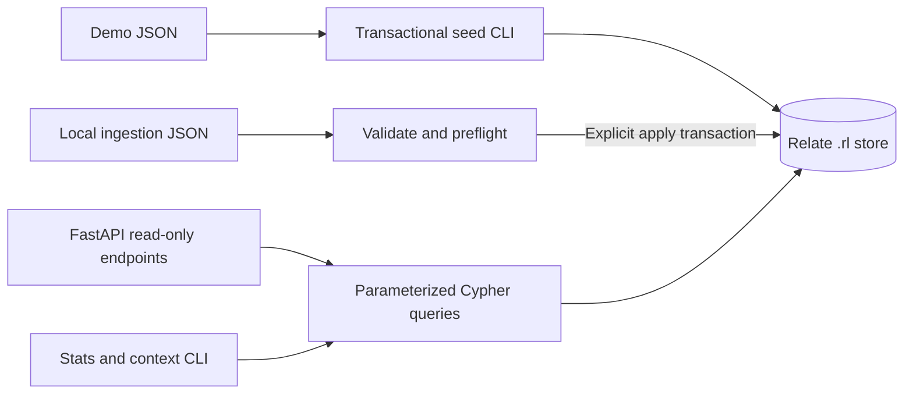

# TraceWeaver

## Local investigation console

The React/TypeScript console consumes a coherent, privacy-conscious snapshot from real Relate.
It shows actual stored arrows, typed claim citations, candidate/evidence records, UTC timeline,
structured comparisons and gaps. It is read-only and deterministic by default.

With Node 24 and the project Python environment installed, build and run from the repo root:

```powershell
npm --prefix web ci
npm --prefix web run build
$env:TRACEWEAVER_DATABASE = './examples/judge-demo/traceweaver-demo.rl'
.\.venv\Scripts\python.exe -m uvicorn traceweaver.api:app --host 127.0.0.1 --port 8000
```

Open [the local console](http://127.0.0.1:8000/?incident=INC-001). The existing synthetic judge
file is read without reseeding. Select INC-001, INC-002 or CASE-INC; inspect graph paths and
server-admitted claims. NOT_ESTABLISHED and external truth NOT_PERFORMED remain explicit.
The [overnight ledger](docs/OVERNIGHT_PROGRESS.md) distinguishes completed gates from remaining work.

**Graph-Verified AI Incident Investigator**

Sprint 00: Foundation, Real Relate Integration & Technical Verification

Sprint 01: Evidence Intelligence & Temporal Investigation

Sprint 02: Trusted Local Ingestion, Source Integrity & Reproducible Evaluation

Sprint 03: Graph-Grounded Explanations, Citation Firewall & Optional Local AI

TraceWeaver prepares connected incident context for investigations: affected services,
dependencies, deployments, code or configuration changes, alerts, and evidence with provenance.
Sprint 00 delivered the local graph, Python CLI, and read-only HTTP API. Sprint 01 adds
deterministic temporal investigation, source traceability, structured observation comparisons,
and explicit uncertainty. Sprint 02 adds validated local ingestion, offline file-integrity checks,
20 frozen evaluation scenarios, and a separately published synthetic Relate store. These features
are implemented and verified locally; remote CI is unverified. Sprint 03 adds a read-only
explanation layer, semantic citation validation and an optional local AI claim selector.
Default deterministic explanations are **not AI-generated**. The AI can select existing facts;
it cannot establish a root cause or write arbitrary factual prose.

## Hackathon context

Prepared for the **Relate by Neo4j Hackathon 2026**, theme **Context, Connected**. All included
records are synthetic **demo data**. They do not represent a real company or production incident.

## Why connected context matters

A payment error metric alone does not explain which dependency, rollout, or change deserves
inspection. TraceWeaver follows actual graph edges from an incident to its affected service,
upstream dependencies, deployments, and changes. It keeps competing candidates and source
evidence visible. **A connected deployment is not a proven cause.**

## Why Relate is essential

The application embeds **`relate-db==1.0.0`**, imported as `relate`. Cypher creates and reads
every graph entity. The context endpoint traverses graph relationships at request time;
it does not return fixture records or a prepared analysis answer. Persistence is a local
single-file `.rl` store. No hosted database, credentials, Docker, or paid service is required.
The optional Relate CLI is a development tool, not a runtime dependency.

Relate is an experimental Neo4j Labs project. See its
[official repository](https://github.com/relatedb/relate) and
[limitations](https://relatedb.ai/docs/reference/limitations/).

## Architecture



- `config.py`: environment configuration and persistent path validation.
- `storage.py`: context-managed Relate connections, errors, transactions, and graph counts.
- `schema.py` / `seed.py`: ID constraints, fixture validation, and additive idempotent import.
- `queries.py`: bounded graph traversals and incident context assembly.
- `models.py`: unchanged legacy Pydantic graph entities and HTTP response contracts.
- `investigation_models.py` / `investigation.py`: shared deterministic investigation contract/service.
- `temporal.py`, `provenance.py`, `contradictions.py`: UTC windows and evidence quality/comparisons.
- `api.py` / `cli.py`: thin HTTP and terminal entry points.
- `ingestion_models.py` / `ingestion.py`: independent ingestion contract 1.0, read-only preflight,
  and explicit transactional apply using the existing storage adapter.
- `local_files.py` / `source_integrity.py`: bounded local-file admission and raw-byte SHA-256.
- `evaluation.py` / `evaluation_models.py`: frozen gold assertions on isolated real stores.
- `judge_demo.py`: guarded synthetic-only bundle construction and read-only inspection.
- `explanation_catalog.py` / `citation_validator.py`: admissible propositions and semantic proof
  checks against one exact returned investigation snapshot.
- `explanation.py` / `explanation_renderer.py`: shared read-only service and controlled narrative.
- `ollama_local.py` / `model_selection.py`: optional fixed-loopback structured claim selection.

See [Architecture](docs/ARCHITECTURE.md), [Graph schema](docs/GRAPH_SCHEMA.md), and the
[Sprint 00 verification report](docs/SPRINT_00_REPORT.md). Sprint 01 is documented in the
[investigation contract](docs/INVESTIGATION_CONTRACT.md) and
[Sprint 01 verification report](docs/SPRINT_01_REPORT.md).
Sprint 02 has an [ingestion contract](docs/INGESTION_CONTRACT.md),
[source verification policy](docs/SOURCE_VERIFICATION_POLICY.md),
[signal taxonomy](docs/SIGNAL_TAXONOMY.md), [evaluation method](docs/EVALUATION_METHOD.md),
[full walkthrough](docs/SPRINT_02_WALKTHROUGH.md), and [verification report](docs/SPRINT_02_REPORT.md).
Sprint 03 has an [explanation contract](docs/EXPLANATION_CONTRACT.md),
[citation/model safety policy](docs/CITATION_AND_MODEL_SAFETY.md),
[walkthrough](docs/SPRINT_03_WALKTHROUGH.md), and [verification report](docs/SPRINT_03_REPORT.md).

## Two-minute synthetic judge walkthrough

After installation, use the included **synthetic-only** artifact. No seed or write is needed:

```powershell
Get-FileHash ./examples/judge-demo/traceweaver-demo.rl -Algorithm SHA256
python -m traceweaver stats --database ./examples/judge-demo/traceweaver-demo.rl
python -m traceweaver context --incident INC-001 --database ./examples/judge-demo/traceweaver-demo.rl
python -m traceweaver investigate --incident INC-001 --database ./examples/judge-demo/traceweaver-demo.rl
python -m traceweaver investigate --incident CASE-INC --database ./examples/judge-demo/traceweaver-demo.rl
$evaluationOutput = Join-Path $env:TEMP ('traceweaver-eval-' + [guid]::NewGuid().ToString('N') + '.json')
python -m traceweaver evaluate --suite ./evaluation/cases.json --output $evaluationOutput
```

The included 110,592-byte store has **51 nodes / 67 relationships** and SHA-256
`29b10010152ebf82fe61b7dd8eff71848f39963e58d7b7a56f0aecebf1150239`.
For INC-001, compare context and investigation for the same incident: two competing deployments
and four evidence records with stored relationship paths. For CASE-INC, inspect six candidates
and eleven evidence records, including intentionally incomplete metadata. Its audit finds one conflicting pair
and two undetermined pairs; `causal_conclusion` stays **NOT_ESTABLISHED**. Relate executes the
traversals against the actual .rl file; no prepared investigation answer replaces graph reads.
Evaluation runs 20 scenarios in separate temporary stores and returns 20 PASS / 0 FAIL.
Perfect agreement with synthetic gold is not real-world incident accuracy. Hash equality is
byte integrity, not authentication. See the [bundle manifest and rebuild guide](examples/judge-demo/README.md).

## Proof-carrying explanations: offline first

With the existing synthetic judge store, run:

```powershell
python -m traceweaver explain --incident INC-001 --database ./examples/judge-demo/traceweaver-demo.rl
python -m traceweaver explain --incident CASE-INC --database ./examples/judge-demo/traceweaver-demo.rl --mode deterministic
$explanationEvaluation = Join-Path $env:TEMP ('traceweaver-explanation-eval-' + [guid]::NewGuid().ToString('N') + '.json')
python -m traceweaver evaluate-explanations --suite ./evaluation/explanation_cases.json --output $explanationEvaluation
```

**DETERMINISTIC / ai_generated_selection=false:** no model, network, key or download is needed.
The real Relate investigation supplies paths, times, evidence and gaps. A bounded catalog offers
specific propositions; a separate firewall validates their semantics and citations. Controlled
English templates display the accepted statements, with NOT_ESTABLISHED as the final caution.
Source prose/references are withheld. Missing evidence abstains, and unknown/truncated/conflicting
context remains visible. The JSON includes an exact investigation/options fingerprint.

The offline suite executes 19 synthetic cases in fresh actual .rl stores. Its checked-in
[JSON report](reports/sprint03-explanation-evaluation.json) records explicit denominators and
adversarial rejection; it is not real-world incident or root-cause accuracy. See actual
[INC-001](docs/examples/INC-001-explanation.json) and [CASE-INC](docs/examples/CASE-INC-explanation.json)
responses. The judge store and all pre-existing fixtures/reports are preserved.

**OLLAMA / ai_generated_selection=true only on acceptance:** if a compatible model is already
installed in local Ollama, opt in explicitly. This local environment verified `qwen3:8b`:

```powershell
python -m traceweaver explain --incident INC-001 --database ./examples/judge-demo/traceweaver-demo.rl --mode ollama --model qwen3:8b
```

Only use a model actually installed on your machine. The adapter checks fixed 127.0.0.1:11434,
never downloads weights, follows redirects or uses cloud/proxy endpoints. A model receives
opaque claim hashes and allowlisted metadata, selects/orders existing IDs, and cannot create
evidence, citations, Cypher or remediation. Invalid selections are rejected with no hidden
fallback; unavailability returns mode_executed=NONE. Model output may vary. A controlled test
transport is not live AI inference; exact local-model evidence is in the Sprint 03 report.

The API adds deterministic-only `GET /incidents/{incident_id}/explanation`, using the existing
window/cap options. It never triggers a model. Keep the development server on loopback.

## Graph model overview

The fixture contains **21 nodes and 27 directed relationships**:

| Node label | Count | Example |
| --- | ---: | --- |
| Incident | 2 | `INC-001`: Payment API 5xx error spike |
| Service | 5 | Payment API, Auth Service, Ledger Service |
| Deployment | 3 | Auth token rotation rollout |
| Change | 3 | Token rotation configuration |
| Evidence | 6 | Auth logs, metrics, distributed traces |
| Alert | 2 | Payment error budget alert |

`INC-001` connects Payment API to Auth Service and its token rotation deployment/change.
A separate Payment API deployment is another investigation candidate. `INC-002` concerns
Notification Service and Message Queue, with independent deployment and evidence records.

## Windows setup and installation

Use Windows x64, PowerShell, Git, and CPython **3.11 or later**. Python 3.11/3.12 are good
choices if already installed. This sprint was verified locally on CPython **3.14.0 x64**;
Relate's `cp39-abi3-win_amd64` wheel supports the installed interpreter. A new Python installation
is unnecessary if your supported interpreter can install the wheel.

From the repository root:

```powershell
python --version
git --version
python -m venv .venv
.\.venv\Scripts\Activate.ps1
python -m pip install -r requirements-dev.lock -e ".[dev]"
python -m pip check
```

If PowerShell policy prevents activation, run commands with
`.\.venv\Scripts\python.exe` instead of changing system policy. For example:

```powershell
.\.venv\Scripts\python.exe -m traceweaver seed --database ./data/traceweaver.rl
```

For a runtime-only installation, use `python -m pip install .` inside the virtual environment.
Developers refreshing dependencies can use `python -m pip install -e ".[dev]"` and reverify
the suite before updating `requirements-dev.lock`. The lock file records the verified development
environment without machine-specific paths.

On Linux, the equivalent activation is `source .venv/bin/activate`.

### Configuration

`.env.example` documents `TRACEWEAVER_DATABASE`; the application does not automatically load
`.env` files. Set it explicitly if you want to override `./data/traceweaver.rl`:

```powershell
$env:TRACEWEAVER_DATABASE = './data/traceweaver.rl'
```

Paths are relative to the process working directory. CLI `--database` overrides the environment.
The API requires a persistent `.rl` file and always opens it read-only.

### Optional official Relate CLI

Python application commands below do not require this tool. On Windows x64, download
`relate-windows-amd64.exe` and `SHA256SUMS` from the
[official v1.0.0 release](https://github.com/relatedb/relate/releases/tag/v1.0.0).
Use `Get-FileHash -Algorithm SHA256` and compare with the exact filename entry in `SHA256SUMS`
**before** executing the downloaded binary. Rename it to `relate.exe` in a user tool directory
on your PATH, or invoke its full path.

```powershell
relate --version
relate --mode envelope 'RETURN 1 AS ok'
relate skill install --agent codex
relate agent-context
```

Do not run the Linux/macOS `install.sh` directly in PowerShell. The CLI skill installer in
v1.0.0 could not resolve its Codex destination in the verified Windows environment. The CLI
itself, including queries and `agent-context`, worked. This does not prevent Python use;
see the report for the exact limitation. The Python wheel also includes a readable Relate
Python `SKILL.md` under its `.agents/skills/relate/` directory.

## Seeding demo data

```powershell
python -m traceweaver seed --database ./data/traceweaver.rl
python -m traceweaver seed --database ./data/traceweaver.rl
```

Both runs print:

```json
{"node_count": 21, "relationship_count": 27}
```

The command creates the directory/store if needed, validates the entire fixture, installs
per-label unique ID constraints, and uses parameterized `MERGE` in one transaction. It closes
the writer before exiting. It never clears the graph. Existing matching demo records are
retained. Conflicting properties cause a rollback and an error rather than an overwrite.
Unrelated user data remains in the store, so total counts may exceed the clean demo totals.

The reviewable fixture is [fixtures/demo_incidents.json](fixtures/demo_incidents.json).
Its identical packaged copy makes seed work from an installed wheel outside the checkout;
a test prevents these copies from drifting. To load an explicitly selected compatible fixture:

```powershell
python -m traceweaver seed --fixture ./fixtures/demo_incidents.json --database ./data/traceweaver.rl
```

Stop API access before reseeding. A `.rl` writer blocks readers in other processes; existing
readers can also prevent a writer from opening. Lock errors are reported, not retried or hidden.

## Running the CLI

```powershell
python -m traceweaver stats --database ./data/traceweaver.rl
python -m traceweaver context --incident INC-001 --database ./data/traceweaver.rl
python -m traceweaver context --incident INC-002 --database ./data/traceweaver.rl
python -m traceweaver investigate --incident INC-001 --pre-minutes 120 --post-minutes 30 --database ./data/traceweaver.rl
```

Commands emit JSON on stdout. `context` includes incident details, affected services,
dependency paths, candidate deployments and changes, evidence with source/time, alerts,
and a four-edge context path. Exit codes: `0` success, `1` configuration/storage/import error,
`2` argument error, `3` unknown incident. Errors go to stderr. Terminal diagnostics may
include the local database path; HTTP errors deliberately omit internal paths and tracebacks.

## Sprint 02 local ingestion and integrity

Use a fresh scratch location and supply the expected digest as a separate operator argument:

```powershell
$scratchStore = Join-Path $env:TEMP ('traceweaver-ingest-' + [guid]::NewGuid().ToString('N') + '.rl')
$expectedSha256 = (Get-Content ./fixtures/ingestion_example.sha256).Split(' ')[0]
python -m traceweaver verify-source --input ./fixtures/ingestion_example.json --expected-sha256 $expectedSha256
python -m traceweaver ingest --input ./fixtures/ingestion_example.json --database $scratchStore
python -m traceweaver ingest --input ./fixtures/ingestion_example.json --database $scratchStore --apply --expected-sha256 $expectedSha256
python -m traceweaver ingest --input ./fixtures/ingestion_example.json --database $scratchStore --apply
python -m traceweaver ingest --input ./fixtures/ingestion_example.json --database $scratchStore --apply
python -m traceweaver investigate --incident ING-INC-001 --database $scratchStore
```

Dry-run is the default and does not create a store. First apply creates 8 nodes / 9 relationships;
both repeated applies create zero. Full validation and known-conflict preflight happen before
the writer opens; apply rechecks within one finite transaction. Conflicting records and extra
user properties are preserved. Non-demo or unknown markers require `--allow-non-demo`; this
local opt-in is not access control. Only synthetic examples are included in this repository.

The contract admits at most 8 MiB, 2,000 nodes and 4,000 relationships, with bounded strings and
JSON depth. Source references are opaque metadata and are never fetched. MATCH establishes
only equality with the supplied digest; external verification is always NOT_PERFORMED.
The example checksum illustrates a separate expected-hash channel; its repository location
does not authenticate its origin. New-tool JSON errors have separate documented exit codes;
old commands retain codes 0/1/2/3. See the [complete conflict and mismatch walkthrough](docs/SPRINT_02_WALKTHROUGH.md).

To reconstruct the synthetic judge bundle, select a new directory:

```powershell
$judgeOutput = Join-Path $env:TEMP ('traceweaver-judge-' + [guid]::NewGuid().ToString('N'))
python -m traceweaver build-judge-demo --output-dir $judgeOutput
```

Existing output is refused by default. `--force` accepts only an intact recognized generated
bundle; it never authorizes replacing a user-supplied store.

## Sprint 01 investigation

`investigate` and the new HTTP endpoint share one read-only service and Pydantic contract:

```powershell
Invoke-RestMethod 'http://127.0.0.1:8000/incidents/INC-001/investigation?pre_minutes=120&post_minutes=30'
```

Window values must be integers in `0..1440`; optional `max_candidates` and `max_evidence` are
integers in `1..100` (CLI flags use hyphens). Defaults are 120 minutes before, 30 after, and
100 items. Original ISO timestamps are retained alongside normalized UTC values. Naive,
invalid, missing, or ambiguous values produce warnings and UNKNOWN classifications.

Actual baseline demo result, shortened to selected fields:

```json
{
  "incident_id": "INC-001",
  "is_demo": true,
  "incident_started_at": "2026-11-10T10:05:00Z",
  "investigation_status": "PARTIAL_CONTEXT",
  "causal_conclusion": "NOT_ESTABLISHED",
  "provenance_audit": {
    "scope": "RETURNED_EVIDENCE",
    "total_evidence": 4,
    "traceable_count": 4,
    "incomplete_count": 0,
    "invalid_count": 0,
    "unverified_external_count": 0
  },
  "contradictions": [],
  "results_may_be_truncated": false
}
```

The baseline has no structured signal observations, so four records are not evaluable for
contradiction detection. That missing comparison data makes the review context partial even
though its time/source metadata is complete. TRACEABLE does not mean externally verified.
Synthetic references are identified as SYNTHETIC; external references remain UNVERIFIED_EXTERNAL.

Candidates include deployments on affected services or up to three dependency hops away,
including deployments without changes. Each has an actual graph path with node IDs, edge types,
stored source/target IDs, and traversal direction. BEFORE means temporal suitability for review;
AFTER and AT_ONSET are retained as context and excluded only as preceding triggers. The sort order
is deterministic presentation, not a cause score. Causation always remains NOT_ESTABLISHED.

New synthetic cases are **opt-in**, with a separate version-2 fixture. Use a fresh temporary store:

```powershell
$demoStore = Join-Path $env:TEMP ('traceweaver-sprint01-' + [guid]::NewGuid().ToString('N') + '.rl')
python -m traceweaver seed --database $demoStore
python -m traceweaver seed --fixture ./fixtures/sprint01_cases.json --database $demoStore
python -m traceweaver investigate --incident CASE-INC --database $demoStore
```

The additive cases contain 30 nodes / 40 edges; combined with the baseline the new temporary
store has 51 nodes / 67 edges. They intentionally include missing/invalid times, incomplete sources,
orphan evidence, an unrelated deployment, and structured HEALTHY/FAILED/DEGRADED observations.
No extra records are imported into the application's default store automatically.

## Running FastAPI

Seed the store first, then run from the repository root with the virtual environment active:

```powershell
python -m uvicorn traceweaver.api:app --host 127.0.0.1 --port 8000
```

Open [Swagger UI](http://127.0.0.1:8000/docs) or inspect [OpenAPI](http://127.0.0.1:8000/openapi.json).
In a second terminal:

```powershell
Invoke-RestMethod http://127.0.0.1:8000/health
Invoke-RestMethod http://127.0.0.1:8000/incidents
Invoke-RestMethod http://127.0.0.1:8000/incidents/INC-001/context
```

| Endpoint | Behavior |
| --- | --- |
| `GET /health` | Queries real graph counts; reports engine `relate` and persistent store |
| `GET /incidents` | Lists up to 100 incidents with ID, title, status, and severity |
| `GET /incidents/{incident_id}/context` | Retrieves connected context through Cypher |
| `GET /incidents/{incident_id}/investigation` | Temporal candidate context, provenance, structured comparisons, uncertainty |
| `GET /incidents/{incident_id}/explanation` | Deterministic-only proof-carrying statements, citations, gaps and explicit abstention |

Unknown incidents return `404`. Missing, corrupt, locked, or unreadable stores return `503`.
Invalid investigation query arguments return `422`. Unexpected failures are logged on the server
and produce a generic `500`. There are no write endpoints. Each request opens, queries, and closes its connection within
one synchronous worker thread, respecting Relate's thread affinity. This is a local development
API with no authentication; keep the demonstrated loopback binding.

## Example Cypher queries

Bind `{"incident_id": "INC-001", "limit": 100}` through `conn.execute(query, params)`:

```cypher
MATCH (i:Incident {id: $incident_id})-[:AFFECTS]->(s:Service)
      -[:DEPENDS_ON]->(dependency:Service)<-[:TARGETS]-(d:Deployment)
      -[:INCLUDES_CHANGE]->(c:Change)
RETURN i.id AS incident_id, s.id AS affected_service_id,
       dependency.id AS dependency_service_id,
       d.id AS deployment_id, c.id AS change_id
ORDER BY incident_id, affected_service_id, dependency_service_id, deployment_id, change_id
LIMIT $limit
```

This follows four actual relationships. `TARGETS` is traversed against its stored direction;
the deployment still points to the dependency service. For `INC-001`, the result identifies
`SVC-PAYMENT`, `SVC-AUTH`, `DEP-001`, and `CHG-001`. No causal conclusion follows from that path.

```cypher
MATCH (:Incident {id: $incident_id})-[:HAS_EVIDENCE]->(e:Evidence)
      -[:OBSERVED_ON]->(s:Service)
RETURN e.id AS evidence_id, e.source AS source, e.source_ref AS source_ref,
       e.timestamp AS timestamp, s.id AS service_id
ORDER BY timestamp, evidence_id, service_id LIMIT $limit
```

## Running tests and checks

```powershell
python -m pytest -q
python -m ruff check .
python -m pip check
```

Tests use the real Relate engine and isolated OS temporary `.rl` stores. They never remove or
reset `data/traceweaver.rl`. Coverage includes engine smoke tests, three seed runs, user data
preservation, real constraint failures and rollback, graph traversal, scenario isolation,
cross-process persistence, read-only enforcement, API file immutability, concurrent reads,
parameter safety, CLI exit codes, and unavailable/corrupt-store handling.

GitHub Actions is configured for **Windows latest / Python 3.11** and **Ubuntu latest /
Python 3.11**. Local Windows verification does not establish that remote CI passed.

## Current capabilities

- Embedded Relate 1.0.0, persistent single-file graph, transactional idempotent demo import.
- Six node labels, seven relationship types, unique IDs, explicit demo provenance.
- Real multi-hop graph context, competing deployment candidates, evidence timestamps/sources.
- CLI and read-only FastAPI with OpenAPI; real-engine integration tests and Ruff checks.
- UTC-normalized bounded temporal investigation, honest missing-data warnings, explicit provenance.
- Incident-scoped structured contradiction/undetermined detection and actual graph paths.
- Shared investigation API/CLI; exact new-list truncation detection and deterministic output.
- Versioned local ingestion, guarded non-demo opt-in, strict validation, and conflict-safe apply.
- Offline SHA-256 comparison, 20 frozen evaluation scenarios, and a synthetic judge .rl bundle.
- Default offline proof-carrying explanation, semantic citation firewall and explicit abstention.
- Optional local Ollama selection over existing claims; no model-generated factual prose or graph writes.

## Roadmap

- **Sprint 01 — Implemented:** deterministic evidence-grounded investigation, time-aware context,
  explicit uncertainty, and provenance metadata validation.
- **Sprint 02 — Implemented and locally verified:** bounded local ingestion, offline source-file
  integrity, reproducible synthetic evaluation, and a packaged judge store.
- **Sprint 03 — Implemented and locally verified:** read-only explanations, citation firewall,
  separate frozen explanation evaluation, and optional real local Ollama claim selection.
- **Sprint 04 — Planned:** visual evidence/citation dashboard and a short judge demonstration,
  with an actual Relate path and optional local model selection.
- **Later:** investigation UI and visualization, only when separately scoped.

## Limitations

- No causal inference, remediation, external ingestion connector, dashboard, cloud AI service, or
  production authentication is implemented through Sprint 03. Local AI selection is optional.
- The legacy `context` endpoint keeps its original topology-only behavior. The new investigation
  endpoint classifies times but does not infer causes or rank causality. Shared dependencies may
  connect candidate deployments across incidents; evidence still requires that incident's HAS_EVIDENCE.
- Dependency expansion is bounded to three hops; each context list is capped at 100 rows.
  `results_may_be_truncated` conservatively flags a context list reaching that cap. The incident
  list has no pagination in this sprint.
- Legacy context retrieval requires change/observed-service edges; the new investigation retains
  deployments without changes and evidence without observations, with explicit gaps.
- The strict legacy context model cannot represent the intentionally invalid/incomplete CASE-INC
  fixture or arbitrary structured ingestion metadata. Use investigate for those records; INC-001
  remains the backward-compatible context example. No old response model was broadened.
- Graph entities follow the strict Sprint 00 demo response contract. Arbitrary externally written
  entity properties need a deliberate schema migration/ingestion design before API exposure.
- Relate holds its working graph in memory and allows one writer process. A `.rl` file cannot
  serve cross-process readers while a writer holds it. Connections cannot cross threads.
- Local verification ran on Windows x64 / Python 3.14.0. Remote CI and Linux execution remain
  unverified until the repository is pushed and the workflow is actually run.
- Investigation uses closed observation intervals or exact instants for structured comparisons.
  HEALTHY versus FAILED can conflict; pairs involving DEGRADED are UNDETERMINED. Narrative text
  alone is never evaluated. Links and timestamps do not establish source truth or causation.
- Investigation lists are capped with real lookahead. Candidate selection first uses graph IDs;
  temporal ordering applies within the selected subset. One shortest simple path per candidate is
  shown. Truncated data and alternate paths are not a complete graph export; see the contract.
- Relate can change physical file bytes when a rolled-back writer closes, despite identical
  committed records. Known ingestion conflicts are rejected read-only before opening a writer;
  conflicts discovered after acquisition roll back logically. No physical byte rewind is promised.
- Row/input caps do not bound high-degree query cost, whole-store memory, or persistent size.
  Evaluation is a small synthetic regression suite, not a production performance benchmark.
- Ingestion source envelopes are input claims returned by the CLI, not an authenticated persistent
  intake registry. Local filesystem/output guards assume trusted, quiescent directories; multi-file
  report/bundle publication is not an atomic filesystem transaction.
- Explanation validates support by returned graph context, not external source truth. Catalog and
  rendered claims are capped independently of the graph. Unsafe display identifiers fail closed.
  The local Ollama daemon is trusted; model supply-chain authentication is outside this sprint.

## AI-assisted development disclosure

Sprints 00 through 03 were implemented and tested with OpenAI Codex assistance. The assistant generated and
reviewed code, fixtures, tests, and documentation, and executed local verification commands.
Only explicit CLI Ollama mode calls a local model; default CLI and HTTP explanations use no model.
Synthetic evidence and connected graph paths
must never be presented as verified real-world root causes.
