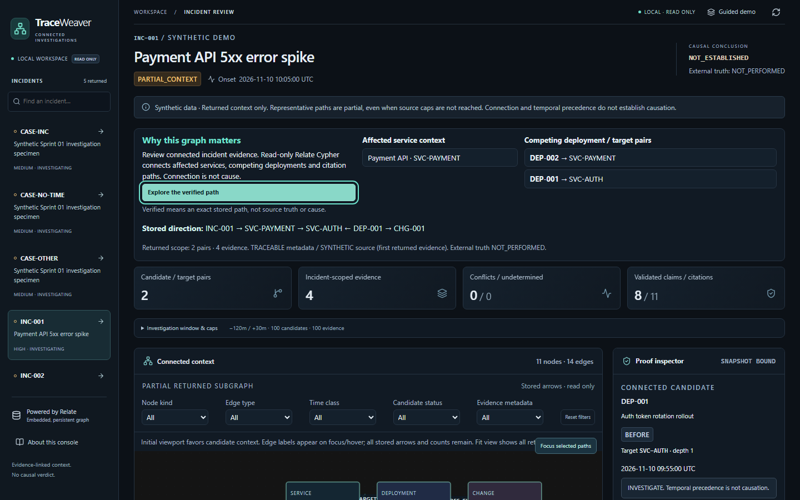

# TraceWeaver — Graph-Verified AI Incident Investigator

Follow connected incident evidence and inspect the exact graph paths behind every admitted claim.

Incident reviews span services, dependency chains, deployments, changes and conflicting observations.
TraceWeaver brings that context into a read-only investigation workspace with inspectable citations.
It helps identify what to investigate next while keeping uncertainty visible.

## Why Relate

**Embedded Relate 1.0.0 is the actual data engine.** Parameterized Cypher traverses a persistent,
single-file `.rl` graph at request time. Six node labels and seven directed relationship types
connect incidents, services, deployments, changes, evidence and alerts.

A stored path in the included judge graph is:

```text
INC-001 → SVC-PAYMENT → SVC-AUTH ← DEP-001 → CHG-001
          AFFECTS / DEPENDS_ON / TARGETS / INCLUDES_CHANGE
```

The deployment-to-service TARGETS arrow is preserved even when traversed backwards. Claims cite
those exact stored relationships, event times and incident-scoped evidence. A text match alone
does not supply that joined proof. Returned context is bounded and partial; connection is not cause.

[Architecture](docs/ARCHITECTURE.md) · [Graph schema](docs/GRAPH_SCHEMA.md) ·
[Relate integration](https://github.com/relatedb/relate)

## Features

| Capability | What you can inspect |
| --- | --- |
| Incident explorer | Affected services, dependency paths and competing deployment/target pairs |
| Evidence ledger | Incident-scoped evidence, provenance metadata and missing information |
| Temporal review | UTC event windows; unknown or invalid timestamps remain unknown |
| Structured comparisons | Same-context conflicts, with UNDETERMINED comparisons kept separate |
| Citation inspector | Server-validated claims, stored edge directions, timestamps and support |
| Offline tool rehearsal | Actual read-only Relate queries and step-by-step proof, without a model |
| Experimental local AI | Optional Ollama tool selection and opaque claim-ID selection, behind the citation firewall |

The five research tools are `get_incident_scope`, `trace_deployment`, `inspect_evidence`,
`compare_observations` and `inspect_gaps`. Each performs bounded native graph reads.
The model cannot submit Cypher, write the graph or author factual statements. See the
[agent tool contract](docs/AGENT_TOOL_CONTRACT.md) and [citation safety policy](docs/CITATION_AND_MODEL_SAFETY.md).



The screenshot shows the deterministic, read-only console. [More genuine captures](docs/screenshots/README.md).

## Quick start

Prerequisites: **Python 3.11+**, **Node 24+**, Git and internet access for the initial package install.
No account, API key, Docker, graph server or model is required.

### Windows / PowerShell

```powershell
git clone https://github.com/HIZMALI/TraceWeaver.git
cd TraceWeaver
python -m venv .venv
.\.venv\Scripts\python.exe -m pip install -r requirements-dev.lock -e ".[dev]"
.\scripts\start-judge-demo.ps1 -Build
```

Open **http://127.0.0.1:8000/?incident=INC-001**. This is your local console, not a hosted demo.
Stop with Ctrl+C. Subsequent launches use `.\scripts\start-judge-demo.ps1`; choose another free
port with `-Port 8001`. The launcher verifies the existing synthetic bundle and never seeds it.

### Linux / Python 3.11

```bash
git clone https://github.com/HIZMALI/TraceWeaver.git
cd TraceWeaver
python3.11 -m venv .venv
.venv/bin/python -m pip install -r requirements-dev.lock -e ".[dev]"
npm --prefix web ci
npm --prefix web run build
.venv/bin/python -m traceweaver.judge --bundle examples/judge-demo --port 8000
```

Windows and Ubuntu Python 3.11 native tests, plus the Ubuntu packaged browser flow, have run in
[GitHub Actions](https://github.com/HIZMALI/TraceWeaver/actions/workflows/ci.yml).
The PowerShell launcher was also tested locally on Windows/Python 3.14.
A built wheel contains console assets and needs no Node at runtime; see [packaging](docs/PACKAGING.md).

## Judge data

| Artifact | Purpose |
| --- | --- |
| [traceweaver-demo.rl](examples/judge-demo/traceweaver-demo.rl) | Real Relate store: **51 nodes / 67 directed relationships** |
| [MANIFEST.json](examples/judge-demo/MANIFEST.json) | Exact byte digest, logical graph digest, fixture sources and demo markers |
| [Bundle guide](examples/judge-demo/README.md) | Read-only inspection and reconstruction in a new directory |

All included records are **synthetic demo data**, not production incidents. The judge store is
inspected read-only. Do not seed, migrate or repair it. Verify after building:

```powershell
.\scripts\check-judge-demo.ps1
```

Linux equivalent: `.venv/bin/python -m traceweaver.judge --bundle examples/judge-demo --check`.
A matching digest establishes byte equality, not source authenticity.

## Demo in under two minutes

After installation, open INC-001:

1. Click **Explore the verified path**: Payment → Auth ← DEP-001 → CHG-001.
   Inspect stored direction separately from reverse traversal.
2. Compare the direct Payment candidate **DEP-002**. Neither candidate is a proven cause.
3. Select an admitted claim and inspect its GRAPH_PATH and TEMPORAL citations.
4. Open **CASE-INC → Observations**: one structured conflict and two UNDETERMINED comparisons.
   Missing or naive event times stay unknown.
5. Return to INC-001 → **Explore investigation steps → Rehearse graph investigation**.
   The offline run executes **four real tools / 23 native queries**, admitting **eight claims /
   eleven citations**. It is deterministic and **not a live model run**.

The gaps view exposes incomplete evidence and bounded context. For troubleshooting and an exact
parameterized Cypher example, see [Judge quick start](docs/JUDGE_QUICK_START.md).

## Tests

The verified release baseline has **574 Python**, **88 frontend** and **54 Chromium** tests:
[observed release run](https://github.com/HIZMALI/TraceWeaver/actions/runs/43472027766).
Python runs on Windows/Ubuntu 3.11; frontend, native browser and independently installed wheel
checks run on Ubuntu. Each push triggers a new run; check its SHA in
[Actions](https://github.com/HIZMALI/TraceWeaver/actions/workflows/ci.yml).

From the installed source checkout on Windows:

```powershell
.\.venv\Scripts\python.exe -m ruff check .
.\.venv\Scripts\python.exe -m pip check
.\.venv\Scripts\python.exe -m pytest -q
npm --prefix web run typecheck
npm --prefix web run lint
npm --prefix web test
npm --prefix web run build
$env:PLAYWRIGHT_BROWSERS_PATH = Join-Path (Get-Location) '.verification/overnight/browsers'
node web/node_modules/@playwright/test/cli.js install chromium
npm --prefix web run test:e2e
```

Tests use isolated real Relate stores; browser captures are written into owned verification
directories. Frozen evaluations contain **35 agent / 20 graph / 19 explanation** cases.
[Evaluation commands and methods](evaluation/README.md) explain the synthetic scopes, controlled
provider cases, negative controls and honest denominators. The illustrative
[graph-versus-flat study](evaluation/graph-vs-flat/README.md) retains its original results and erratum;
it establishes no universal retrieval advantage.

## Limitations

- Synthetic examples do not establish production accuracy or reliability.
- Causal conclusion remains **NOT_ESTABLISHED**; external source verification is **NOT_PERFORMED**.
  TRACEABLE describes metadata quality, not independently verified truth.
- Source/display caps and representative paths omit context. Row limits do not bound native RAM
  or total graph-query cost.
- Optional Ollama is experimental, explicit and fixed to local loopback. No model is downloaded.
  Historical qwen3:8b source-service tool use succeeded; reliable live-browser agent completion
  remains **unverified**. Availability and latency can fail; offline results remain usable.
- A first-load graph initialization flake was observed once during overlapping browser checks.
  Subsequent complete local and hosted runs passed; the timing cause was not established.
- The HTTP console is a single-user, unauthenticated local tool. Bind only to numeric loopback.

Technical references:

| Area | Documentation |
| --- | --- |
| Investigation and ingestion | [Investigation](docs/INVESTIGATION_CONTRACT.md), [ingestion](docs/INGESTION_CONTRACT.md) |
| Explanation and browser | [Explanation](docs/EXPLANATION_CONTRACT.md), [dashboard](docs/DASHBOARD_CONTRACT.md) |
| Evidence policy | [Source integrity](docs/SOURCE_VERIFICATION_POLICY.md), [signals](docs/SIGNAL_TAXONOMY.md) |
| Evaluation | [Method](docs/EVALUATION_METHOD.md), [gold review](evaluation/EXPLANATION_GOLD_REVIEW.md) |

## License & notices

Eligible original project material is licensed under **[Apache-2.0](LICENSE)**.
See [NOTICE](NOTICE), [dependency licenses](docs/DEPENDENCY_LICENSES.md) and the
[full frontend notices](web/public/assets/third-party-licenses.txt). Third-party code, trademarks
and separately provisioned models/media retain their own terms.
