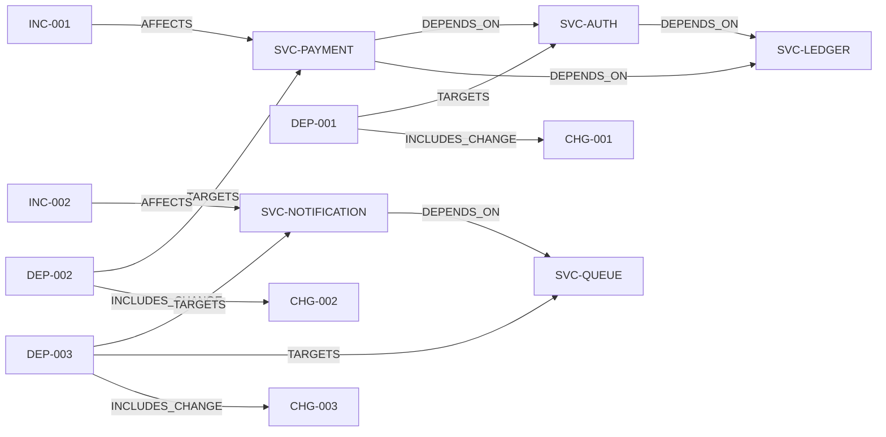

# Graph schema — Sprint 00

All fixture entities are **synthetic demo data** with `demo: true`,
`dataset_id: "traceweaver-sprint00-demo-v1"`, and `environment: "demo"`.
Every relationship also carries `demo` and `dataset_id`. IDs are stable fixture identifiers,
not transient engine element IDs. Each node label has an engine-enforced unique `id` constraint.
The fixture validator additionally enforces globally distinct fixture IDs.

## Nodes and properties

| Label | Count | Required properties in addition to `id`, `demo`, `dataset_id`, `environment` |
| --- | ---: | --- |
| Incident | 2 | `title`, `summary`, `severity`, `status`, `timestamp` |
| Service | 5 | `name`, `description` |
| Deployment | 3 | `name`, `description`, `timestamp`, `source`, `source_ref` |
| Change | 3 | `name`, `description`, `timestamp`, `source`, `source_ref` |
| Evidence | 6 | `summary`, `description`, `timestamp`, `source`, `source_ref` |
| Alert | 2 | `name`, `severity`, `timestamp`, `source`, `source_ref` |

Times are ISO 8601 strings with explicit timezone information; fixture values consistently
use UTC `Z`. Evidence timestamps represent observation time, not insertion time. Source names
identify distinct synthetic channels; `demo://...` references make their non-production nature
explicit. The incident timestamp is the recorded demo onset, not a confirmed causal boundary.

## Directed relationships and cardinalities

Cardinalities below describe the intended domain. Relate enforces node ID uniqueness;
endpoint labels, directions, and duplicate relationships are checked by fixture validation
and `MERGE`. The engine does not enforce these domain cardinalities for arbitrary external writes.

| Relationship | Stored direction | Intended cardinality | Meaning and reason |
| --- | --- | --- | --- |
| AFFECTS | Incident → Service | Many-to-many; an investigated incident should affect ≥1 service | Starting point for impact context |
| DEPENDS_ON | Service → Service | Many-to-many, 0..N on both sides | Directed upstream service dependency; propagates investigation context |
| TARGETS | Deployment → Service | Many-to-many; deployment targets ≥1 service | Identifies where a rollout was applied, without claiming causation |
| INCLUDES_CHANGE | Deployment → Change | Many-to-many; seeded deployments include ≥1 change | Associates rollout context with inspectable code/configuration changes |
| HAS_EVIDENCE | Incident → Evidence | Many-to-many; 0..N on both sides | Explicit incident evidence membership; avoids evidence selection by text/name |
| OBSERVED_ON | Evidence → Service | Many-to-many; seeded evidence observes ≥1 service | Grounds observations in actual affected/dependency services |
| RAISED_FOR | Alert → Incident | Each seeded alert has one incident; incidents have 0..N alerts | Preserves the signal that raised investigation attention |

The observation model can support a shared evidence record or multi-service deployment.
Sprint 00 does not add `ROOT_CAUSE` or `CAUSED_BY`. A path is context, not proof of cause.

## Fixture topology



`INC-001` owns evidence EVD-001..004, observed on Payment API and Auth Service, and alert ALT-001.
`INC-002` owns EVD-005..006, observed on Notification Service and Message Queue, and ALT-002.
The two service subgraphs are disjoint, so the fixture's query results stay isolated.
Real shared service dependencies could legitimately connect future incident contexts.

| Relationship | Count |
| --- | ---: |
| AFFECTS | 2 |
| DEPENDS_ON | 4 |
| TARGETS | 4 |
| INCLUDES_CHANGE | 3 |
| HAS_EVIDENCE | 6 |
| OBSERVED_ON | 6 |
| RAISED_FOR | 2 |
| **Total** | **27** |

## Schema and seed queries

The same constraint is installed for each of the six allowlisted labels:

```cypher
CREATE CONSTRAINT traceweaver_incident_id IF NOT EXISTS
FOR (n:Incident) REQUIRE n.id IS UNIQUE
```

Node and relationship writes bind values, use `MERGE`, and happen inside an explicit transaction:

```cypher
MERGE (n:Incident {id: $id}) ON CREATE SET n += $properties
RETURN properties(n) AS properties LIMIT 1
```

```cypher
MATCH (a:Incident {id: $source}), (b:Service {id: $target})
MERGE (a)-[r:AFFECTS]->(b)
ON CREATE SET r.demo = true, r.dataset_id = $dataset_id
```

Seed compares existing properties with the fixture and rolls back on conflicts. It does not
update a conflicting user-owned node, remove unrelated data, or reset the graph.

## Read queries

Graph counts are separate reducing aggregates:

```cypher
MATCH (n) RETURN count(n) AS node_count
```

```cypher
MATCH ()-[r]->() RETURN count(r) AS relationship_count
```

Bind `incident_id` and `limit` in the following reads. The source implementation in
`queries.py` also retrieves affected services, bounded dependency sequences, deployments
on affected or dependency services, alerts, and incident details.

```cypher
MATCH (i:Incident {id: $incident_id})-[:AFFECTS]->(s:Service)
      -[:DEPENDS_ON]->(dependency:Service)<-[:TARGETS]-(d:Deployment)
      -[:INCLUDES_CHANGE]->(c:Change)
RETURN DISTINCT i.id AS incident_id, s.id AS affected_service_id,
       dependency.id AS dependency_service_id, d.id AS deployment_id, c.id AS change_id,
       ['AFFECTS', 'DEPENDS_ON', 'TARGETS', 'INCLUDES_CHANGE'] AS relationship_types
ORDER BY affected_service_id, dependency_service_id, deployment_id, change_id
LIMIT $limit
```

Actual clean-demo result for `INC-001`:

```json
[{"incident_id":"INC-001","affected_service_id":"SVC-PAYMENT",
  "dependency_service_id":"SVC-AUTH","deployment_id":"DEP-001","change_id":"CHG-001",
  "relationship_types":["AFFECTS","DEPENDS_ON","TARGETS","INCLUDES_CHANGE"]}]
```

This is four graph edges, with `TARGETS` traversed backwards. Evidence retrieval is scoped
through `HAS_EVIDENCE`, retaining the service association:

```cypher
MATCH (:Incident {id: $incident_id})-[:HAS_EVIDENCE]->(e:Evidence)
      -[:OBSERVED_ON]->(s:Service)
RETURN properties(e) AS evidence, properties(s) AS service
ORDER BY e.timestamp, e.id, s.id LIMIT $limit
```

Graph context uses up to three dependency hops and 100 rows per list. It includes multiple
deployment candidates and makes no temporal filtering or causal ranking claim.
